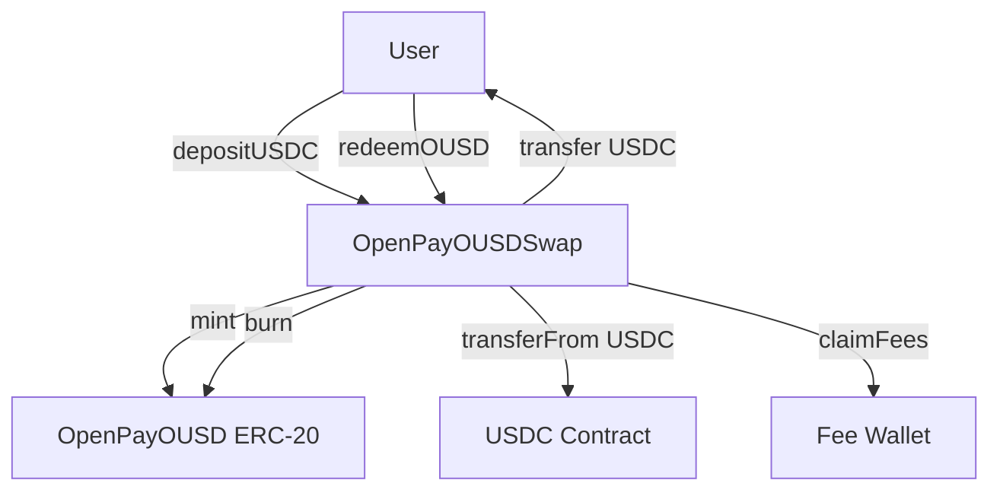

# OpenPay OpenUSD (OUSD) — Smart Contract Design Doc

**Status:** Draft  
**Authors:** OpenPay / MrWain Foundation  
**Target chain:** Arc Testnet → Arc Mainnet (EVM, Paris hardfork, chain IDs 5042002 / 5042)  
**Language / toolchain:** Solidity ^0.8.20, Foundry (forge build / forge test), OpenZeppelin 5.x  
**Milestone:** v1.0 — initial token + swap deployment  

**Review tracker:**
- [ ] Design review
- [ ] Security review
- [ ] Ops review
- [ ] Compliance review

---

## 2. Action Items (living)

_Populated after each review round._

---

## 3. Goals / Non-Goals

### Goals
- Deploy a USD-pegged ERC-20 token (OUSD) on Arc with 1:1 USDC backing at all times.
- Allow any user to mint OUSD by depositing USDC into the swap contract (1:1 minus platform fee).
- Allow any user to redeem OUSD for USDC from the swap contract (1:1 minus platform fee).
- Collect a 1% platform fee (min $0.01, max $5 USDC) on each mint and each redeem, sent to the OpenPay fee wallet.
- Keep token and swap logic in separate contracts so the token can be used independently of the swap.
- Owner can pause the swap contract in an emergency without pausing the token itself.
- Two-step ownership transfer for both contracts.

### Non-Goals
- No staking, savings, or yield logic (handled by OpenPaySavings contract separately).
- No bridging or cross-chain transfer of OUSD in this version.
- No EIP-2612 permit on OUSD in v1 (may be added later without storage incompatibility).
- No upgradeable proxy — both contracts are immutable; migration path is a new deployment.
- No price oracle — 1:1 exchange rate is hardcoded, not fed.
- No on-chain governance or timelock on ownership in v1 (owner is a single EOA; recommend multisig before mainnet).

---

## 4. Requirements

### Functional
- F1: OUSD is an ERC-20 with 6 decimals (matching USDC on Arc).
- F2: Total supply of OUSD always equals USDC held by the swap contract (resting-state invariant).
- F3: Only the swap contract address (set at deploy time on the token) can call `mint` and `burn` on the token.
- F4: `mintOUSD(uint256 usdcAmount)` deposits `usdcAmount` USDC into the swap contract, deducts the platform fee, mints `usdcAmount - fee` OUSD to the caller.
- F5: `redeemOUSD(uint256 ousdAmount)` burns `ousdAmount` OUSD from the caller, deducts the platform fee in USDC terms, sends `ousdAmount - fee` USDC to the caller.
- F6: Platform fee: 1% of the amount, minimum 10 (0.000010 USDC in 6-decimal units = $0.00001), capped at 5_000_000 (5 USDC). Fee is sent to `feeWallet` immediately on each operation via `pendingFees` accumulation pattern (fee never blocks operation if feeWallet is blocklisted — owner claims separately via `claimFees()`).
- F7: Swap contract owner can pause and unpause the swap (blocks mint/redeem while paused, token transfers unaffected).
- F8: Two-step ownership (`Ownable2Step`) on both contracts — new owner must accept.
- F9: Owner can update `feeWallet` address.
- F10: Owner can call `claimFees()` to sweep accumulated `pendingFees` to `feeWallet`.

### Security
- S1: No path lets any address other than the registered swap contract mint or burn OUSD.
- S2: A compromised `feeWallet` cannot halt any swap (fee is accrued, not pushed per-tx).
- S3: Reentrancy: all state updates before external USDC/OUSD transfers (CEI).
- S4: `SafeERC20` used for all USDC calls (handles non-standard return values).
- S5: Swap contract can hold no USDC in excess of total OUSD supply (checked via invariant in `redeemOUSD`).
- S6: Paused state blocks mint/redeem but not token-to-token transfers — users retain exit rights even while paused.
- S7: Owner cannot renounce ownership; two-step transfer only.

---

## 5. Terminology & Actors

| Term | Definition |
|------|-----------|
| OUSD | OpenPay OpenUSD — the ERC-20 token being deployed |
| USDC | USD Coin at `0x3600000000000000000000000000000000000000` on Arc |
| Swap Contract | `OpenPayOUSDSwap` — holds USDC reserves, mints/burns OUSD |
| Fee Wallet | `0x9853332ecae783514af8d39854f4a1762e152dc9` — collects platform fees |
| Minter | The swap contract only — sole authorized minter/burner of OUSD |
| Owner | Single EOA (deployer) — controls pause, fee params, fee claim, ownership transfer |

| Actor | On/Off-chain | Trust level | What they can do |
|-------|-------------|-------------|-----------------|
| Owner | Off-chain EOA | Trusted | Pause/unpause swap, update feeWallet, claim fees, transfer ownership |
| Swap contract | Onchain | Trusted | Mint and burn OUSD |
| User | Onchain EOA or contract | Untrusted | mintOUSD, redeemOUSD, transfer OUSD |
| Fee wallet | Off-chain recipient | Semi-trusted | Receives claimed fees; compromise cannot halt swaps |

---

## 6. Language / Runtime

- **Solidity ^0.8.20** — built-in overflow checks, custom errors, immutable variables.
- **EVM hardfork: Paris** — Arc Testnet and Arc Mainnet both run Paris. No Cancun opcodes (no `mcopy`, `tstore`, `tload`, `PUSH0` equivalent via transient storage).
- **OpenZeppelin 5.x** imports: `ERC20`, `Ownable2Step`, `Pausable`, `SafeERC20`, `IERC20`.
- No proxy, no `initialize` — plain constructor deployment.

---

## 7. Transaction & Execution Model

All operations are single atomic EVM transactions. Re-entry surface: both `mintOUSD` and `redeemOUSD` make external ERC-20 calls. CEI discipline is applied: all state (supply tracking, pendingFees) is updated before external calls. No `nonReentrant` guard is added because Arc's USDC is a trusted contract with no callback hooks, but CEI alone is sufficient and is documented here.

---

## 8. Chain Standards & Interfaces

- **ERC-20** (OpenZeppelin 5.x implementation), 6 decimals.
- No ERC-2612 permit in v1.
- No ERC-1271 (no contract-account signers in scope).

| EVM Role | Ability | This Contract |
|----------|---------|---------------|
| `owner` | Pause, fee config, ownership transfer | `Ownable2Step` on both contracts |
| `minter` | Mint/burn token | Only `OpenPayOUSDSwap` address, set immutably at deploy |
| `pauser` | Pause/unpause swaps | Owner (combined role — acceptable for v1 single owner) |

---

## 9. Architecture Overview

### Components



### Mint flow (USDC → OUSD)

```
User calls mintOUSD(usdcAmount)
  1. Check: not paused, usdcAmount > 0
  2. Compute fee = min(usdcAmount * feeBps / 10000, feeCapUsdc), max(fee, feeMin)
  3. ousdMinted = usdcAmount - fee
  4. State: pendingFees += fee
  5. External: USDC.transferFrom(user, swapContract, usdcAmount)  [pull]
  6. External: OUSD.mint(user, ousdMinted)
  7. Emit Minted(user, usdcAmount, ousdMinted, fee)
```

### Redeem flow (OUSD → USDC)

```
User calls redeemOUSD(ousdAmount)
  1. Check: not paused, ousdAmount > 0
  2. Compute fee = min(ousdAmount * feeBps / 10000, feeCapUsdc), max(fee, feeMin)
  3. usdcOut = ousdAmount - fee
  4. State: pendingFees += fee
  5. External: OUSD.burn(user, ousdAmount)  [burns from caller]
  6. External: USDC.transfer(user, usdcOut)
  7. Emit Redeemed(user, ousdAmount, usdcOut, fee)
```

### Flow-of-funds table

| Step | Who moves what | Invariant |
|------|----------------|-----------|
| mintOUSD | User → SwapContract: usdcAmount USDC | USDC balance of swap increases by usdcAmount |
| mintOUSD | SwapContract → User: ousdMinted OUSD | OUSD supply increases by ousdMinted |
| mintOUSD | fee accrued in pendingFees | pendingFees += fee |
| redeemOUSD | SwapContract burns ousdAmount OUSD | OUSD supply decreases by ousdAmount |
| redeemOUSD | SwapContract → User: usdcOut USDC | USDC balance of swap decreases by usdcOut |
| redeemOUSD | fee accrued in pendingFees | pendingFees += fee |
| claimFees | SwapContract → feeWallet: pendingFees USDC | pendingFees = 0 after claim |

**Resting-state invariant:** `USDC.balanceOf(swapContract) == OUSD.totalSupply() + pendingFees`

---

## 10. Contract Design

### OpenPayOUSD (token)

**Roles:**

| Role | Holder | Permissions |
|------|--------|-------------|
| owner | Deployer (Ownable2Step) | Transfer ownership only |
| minter | `swapContract` (immutable) | Call `mint(to, amount)` and `burn(from, amount)` |

**State variables:**

| Variable | Type | Description |
|----------|------|-------------|
| `swapContract` | `address public immutable` | Only address that can mint/burn |
| Inherited ERC-20 | — | `_balances`, `_totalSupply`, `_allowances`, `name`, `symbol`, `decimals` |
| Inherited Ownable2Step | — | `_owner`, `_pendingOwner` |

**Key write functions:**

| Function | Caller | State mutated | Events | Reverts |
|----------|--------|---------------|--------|---------|
| `mint(address to, uint256 amount)` | `swapContract` only | `_totalSupply`, `_balances[to]` | `Transfer(0x0, to, amount)` | `NotSwapContract()`, `ZeroAddress()`, `ZeroAmount()` |
| `burn(address from, uint256 amount)` | `swapContract` only | `_totalSupply`, `_balances[from]` | `Transfer(from, 0x0, amount)` | `NotSwapContract()`, `ZeroAddress()`, `ZeroAmount()`, `InsufficientBalance()` |
| `transferOwnership(address)` | owner | `_pendingOwner` | `OwnershipTransferStarted` | not zero address |
| `acceptOwnership()` | pending owner | `_owner`, `_pendingOwner` | `OwnershipTransferred` | caller != pendingOwner |

### OpenPayOUSDSwap (swap/reserve)

**Roles:**

| Role | Holder | Permissions |
|------|--------|-------------|
| owner | Deployer (Ownable2Step) | Pause/unpause, setFeeWallet, claimFees, transfer ownership |

**State variables:**

| Variable | Type | Description |
|----------|------|-------------|
| `usdc` | `address public immutable` | USDC token address |
| `ousd` | `IOpenPayOUSD public immutable` | OUSD token address |
| `feeWallet` | `address public` | Receives claimed fees |
| `feeBps` | `uint256 public` | Fee in basis points, default 100 (1%), max 200 |
| `feeCapUsdc` | `uint256 public` | Max fee per tx, default 5_000_000 (5 USDC) |
| `feeMinUsdc` | `uint256 public` | Min fee per tx, default 10 (0.00001 USDC) |
| `pendingFees` | `uint256 public` | Accumulated unclaimed fees |
| Inherited Ownable2Step | — | `_owner`, `_pendingOwner` |
| Inherited Pausable | — | `_paused` |

**Key write functions:**

| Function | Caller | State mutated | Events | Reverts |
|----------|--------|---------------|--------|---------|
| `mintOUSD(uint256 usdcAmount)` | Anyone, not paused | `pendingFees` | `Minted` | `Paused`, `ZeroAmount`, USDC transferFrom failure |
| `redeemOUSD(uint256 ousdAmount)` | Anyone, not paused | `pendingFees` | `Redeemed` | `Paused`, `ZeroAmount`, USDC transfer failure |
| `claimFees()` | owner | `pendingFees = 0` | `FeesClaimed` | no pending fees |
| `setFeeWallet(address)` | owner | `feeWallet` | `FeeWalletUpdated` | zero address |
| `setFeeBps(uint256)` | owner | `feeBps` | `FeeBpsUpdated` | > 200 |
| `setFeeCapUsdc(uint256)` | owner | `feeCapUsdc` | `FeeCapUpdated` | < feeMinUsdc |
| `pause()` / `unpause()` | owner | `_paused` | `Paused` / `Unpaused` | — |

**Events:**

| Event | Params | When |
|-------|--------|------|
| `Minted` | `indexed payer, usdcIn, ousdOut, fee` | On each mintOUSD |
| `Redeemed` | `indexed redeemer, ousdIn, usdcOut, fee` | On each redeemOUSD |
| `FeesClaimed` | `amount` | On claimFees |
| `FeeWalletUpdated` | `newWallet` | On setFeeWallet |
| `FeeBpsUpdated` | `newBps` | On setFeeBps |
| `FeeCapUpdated` | `newCap` | On setFeeCapUsdc |

---

## 11. Specification Tables

### 11.1 Token (OpenPayOUSD)

**Principles:**
1. Total supply always equals the sum of all non-zero balances.
2. Only `swapContract` can change total supply.
3. No address can transfer more than its balance.
4. Ownership follows `Ownable2Step` — two-step only, no renounce.

| Functionality | Restriction | Event | Audit Note |
|--------------|-------------|-------|------------|
| Transfer | Holder, amount ≤ balance | `Transfer` | Standard ERC-20 |
| Approve | Holder | `Approval` | Standard ERC-20 |
| Mint | Only swapContract, to ≠ 0x0, amount > 0 | `Transfer(0x0, to, amount)` | Custom guard `NotSwapContract` |
| Burn | Only swapContract, from has sufficient balance | `Transfer(from, 0x0, amount)` | Custom guard `NotSwapContract` |

### 11.2 Swap (OpenPayOUSDSwap)

**Principles:**
1. `USDC.balanceOf(swapContract) == OUSD.totalSupply() + pendingFees` at rest.
2. Fee never blocks a swap — it is accrued, not pushed to feeWallet per-tx.
3. Pause only blocks mint/redeem; OUSD transfers remain live.
4. Fees cannot exceed 2% (200 bps) by contract constraint.

| Functionality | Restriction | Event | Audit Note |
|--------------|-------------|-------|------------|
| mintOUSD | Not paused, amount > 0 | `Minted` | CEI: state before transferFrom |
| redeemOUSD | Not paused, amount > 0, swap holds enough USDC | `Redeemed` | CEI: burn before transfer |
| claimFees | Owner only | `FeesClaimed` | Sets pendingFees = 0 first |
| pause/unpause | Owner only | `Paused`/`Unpaused` | Token not paused |
| setFeeWallet | Owner only, ≠ 0x0 | `FeeWalletUpdated` | — |

---

## 12. Deployment & Initialization

**Deploy order (strict):**
1. Deploy `OpenPayOUSD(name, symbol, owner)` — records deployer as owner, `swapContract` address not yet known.
2. Deploy `OpenPayOUSDSwap(usdc, ousd, feeWallet, owner)` — constructor arguments:
   - `usdc`: `0x3600000000000000000000000000000000000000`
   - `ousd`: address from step 1
   - `feeWallet`: `0x9853332ecae783514af8d39854f4a1762e152dc9`
   - `owner`: deployer `0x5B12Ce46C7194aD57d143bC22847224047b1Ef42`
3. Call `OpenPayOUSD.setSwapContract(swapContractAddress)` from owner — this is a one-time call; once set, `swapContract` is frozen and cannot be changed.

**Constructor args (testnet):**
- OUSD: `("OpenPay OpenUSD", "OUSD", 0x5B12Ce46C7194aD57d143bC22847224047b1Ef42)`
- Swap: `(0x3600000000000000000000000000000000000000, <ousd_address>, 0x9853332ecae783514af8d39854f4a1762e152dc9, 0x5B12Ce46C7194aD57d143bC22847224047b1Ef42)`

---

## 13. Upgradeability

Neither contract is upgradeable. Both are immutable after deployment. Migration path if needed: deploy new contracts, call `OpenPayOUSD.setSwapContract(newSwap)` if only swap changes (requires keeping `setSwapContract` callable — see note in §10). For a full token migration: new token + new swap, announce migration, give users time to redeem OUSD → USDC through the old swap before deprecating.

---

## 14. Key Management & Signing

- Owner key: `0x5B12Ce46C7194aD57d143bC22847224047b1Ef42` — single EOA. Recommended to transfer to a multisig before mainnet.
- No off-chain signing in scope.
- No EIP-712 / Permit2 in v1.

---

## 15. Security Considerations

| Vulnerability | Applicable? | Mitigation |
|--------------|-------------|------------|
| Reentrancy | Yes — external USDC/OUSD calls in mintOUSD and redeemOUSD | CEI: all state (pendingFees, burn) updated before external transfers |
| Access control | Yes — mint/burn restricted to swapContract | `NotSwapContract()` custom error; `swapContract` set once via `setSwapContract`, frozen after |
| Integer overflow/underflow | Solidity 0.8.20 checked | No `unchecked` blocks used |
| Unchecked external call | Yes — USDC transferFrom/transfer | `SafeERC20` wrapping all USDC calls |
| Fee-on-transfer tokens | N/A — USDC on Arc is not fee-on-transfer | — |
| Signature replay | N/A — no off-chain signing | — |
| Front-running / MEV | Low — 1:1 fixed rate, no slippage | No slippage protection needed; rate is always 1:1 |
| Flash-loan manipulation | N/A — no price oracle, rate is hardcoded | — |
| Oracle manipulation | N/A — no oracle used | — |
| Denial of service | Yes — feeWallet blocklist could halt per-tx fee push | Fee accrued in `pendingFees`, not pushed per-tx; owner claims separately |
| Proxy safety | N/A — no proxy | — |
| Timestamp dependence | N/A — no time-dependent logic | — |
| Approval persistence | Low — users approve swap contract | Approve exact amount; no dangling max-approvals needed by the contract itself |
| Centralization risk | Yes — single owner EOA | Document; recommend multisig before mainnet; two-step transfer prevents accidental key loss |

---

## 16. Trust Model & Threat Analysis

| Actor compromised | Max damage | Mitigation | Detection |
|-------------------|-----------|------------|-----------|
| Owner key | Pause swaps indefinitely; change feeWallet; drain pendingFees to attacker wallet | Two-step ownership; recommend multisig on mainnet | Monitor `Paused`, `FeeWalletUpdated`, `OwnershipTransferStarted` events |
| Fee wallet | Receive fees only (cannot trigger any contract action) | pendingFees pattern decouples from swaps | Monitor `FeesClaimed` events |
| swapContract | Mint/burn OUSD freely (but constrained to the swap logic at deployment) | swapContract is a trusted contract, not an EOA | Monitor `Transfer(0x0, ...)` mints not matching a `Minted` event |

---

## 17. Emergency Response & Circuit Breakers

- **Pause:** Owner calls `OpenPayOUSDSwap.pause()` — blocks all `mintOUSD` and `redeemOUSD`. Token transfers continue. Users can still transfer OUSD peer-to-peer.
- **Fee wallet rotation:** Owner calls `setFeeWallet(newAddress)` — no locked fees lost (pendingFees remain in contract until claimed).
- **Stuck USDC:** If USDC is sent directly to the token contract (not the swap), it is not recoverable in v1 (no Rescuable). Recommend adding a `rescue(address token, address to, uint256 amount)` owner-only function in a future version.

---

## 18. Failure Scenarios

**Partial mintOUSD failure (USDC transferFrom reverts):**  
State updates (pendingFees) occur before the transferFrom. If transferFrom reverts, the entire transaction reverts — pendingFees is not permanently incremented. No funds at risk.

**Partial redeemOUSD failure (USDC transfer reverts after burn):**  
CEI: OUSD is burned before USDC is transferred. If USDC transfer fails (e.g., contract out of USDC), the transaction reverts — burn is also rolled back. The resting-state invariant holds.

**claimFees with feeWallet blocklisted:**  
claimFees transfers USDC to feeWallet. If feeWallet is blocklisted, this call reverts, but pendingFees remain intact. Owner calls `setFeeWallet` to a non-blocklisted address, then retries.

---

## 19. Priorities & Tradeoffs

| Decision | Tradeoff | Rationale |
|----------|----------|-----------|
| Separate token + swap contracts | More deployment steps; two addresses for integrators | Keeps token reusable independently of swap logic; swap can be upgraded without affecting token holders |
| Fee accrued in `pendingFees` (not pushed per-tx) | Owner must call `claimFees` manually | Prevents any feeWallet-side revert from bricking all swaps — availability > convenience |
| No upgradeable proxy | Cannot fix bugs in deployed code without migration | Simplicity and auditability; removes proxy storage collision risks; migration story documented |
| Single owner EOA for v1 | High centralization risk | Acceptable for testnet launch; recommend multisig transfer before mainnet |
| `setSwapContract` one-time setter | No way to rotate swap without a new token deployment | Prevents any owner from pointing OUSD mint/burn at an arbitrary contract after launch |

---

## 20. Testing Strategy

**Unit tests (Foundry):**
- Token: mint/burn access control, transfer, zero-address guards
- Swap: mintOUSD happy path, redeemOUSD happy path, fee calculation, fee cap, fee min, pause guard, claimFees, setFeeWallet, resting-state invariant after each operation

**Fuzz tests:**
- `testFuzz_mintOUSD(uint256 amount)` — verify `USDC_in == OUSD_out + fee` for all non-zero amounts
- `testFuzz_redeemOUSD(uint256 amount)` — verify `OUSD_in == USDC_out + fee`

**Static analysis:** Slither on both contracts before deploy.

**Commands:**
```
forge test --match-path "contracts/test/OpenPayOUSD*.t.sol" -vvv
forge test --gas-report
slither contracts/OpenPayOUSD.sol contracts/OpenPayOUSDSwap.sol
```

---

## 21. Third-Party Libraries

| Library | Version | Dependency? | Why | Audited? |
|---------|---------|------------|-----|---------|
| OpenZeppelin ERC20 | 5.x | Yes (pre-installed) | Standard ERC-20 base | Yes |
| OpenZeppelin Ownable2Step | 5.x | Yes | Two-step ownership | Yes |
| OpenZeppelin Pausable | 5.x | Yes | Emergency pause | Yes |
| OpenZeppelin SafeERC20 | 5.x | Yes | Safe USDC calls | Yes |

---

## 22. Monitoring & Alerting

| Event | Threshold | Severity | Action |
|-------|-----------|----------|--------|
| `Paused` | Any | High | Notify team immediately |
| `OwnershipTransferStarted` | Any | High | Verify intent with owner |
| `FeeWalletUpdated` | Any | Medium | Confirm authorized change |
| `Minted` with no matching USDC deposit | Any | Critical | Investigate minter access |
| `pendingFees` > 100 USDC for > 7 days | Sustained | Low | Remind owner to claimFees |

---

## 23. Cross-Functional Stakeholders

| Stakeholder | Review scope |
|-------------|-------------|
| Smart contract security | §15, §16, §18 |
| Platform ops | §12, §17, §22 |
| Compliance | §5 (actors), §16 (centralization) |
| Frontend (OpenPay Arc app) | §9 (flows), §10 (function signatures, events) |
